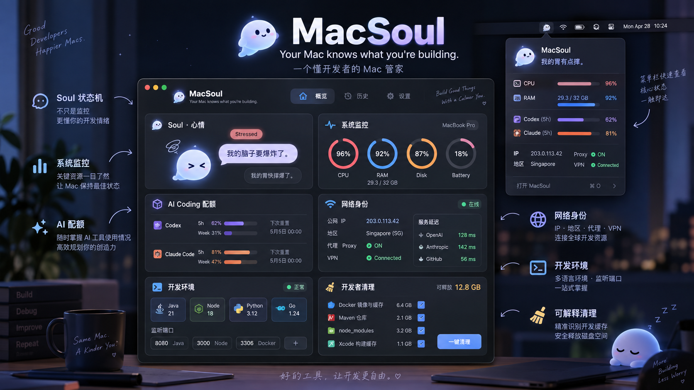
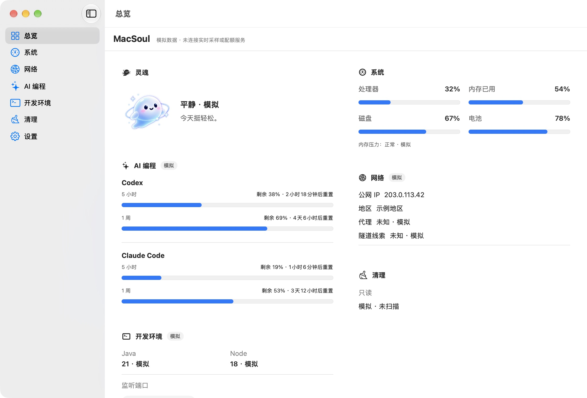
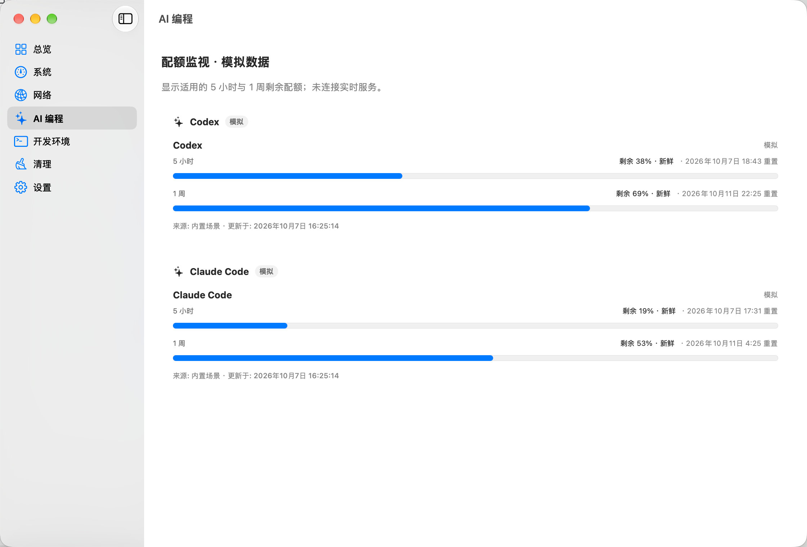
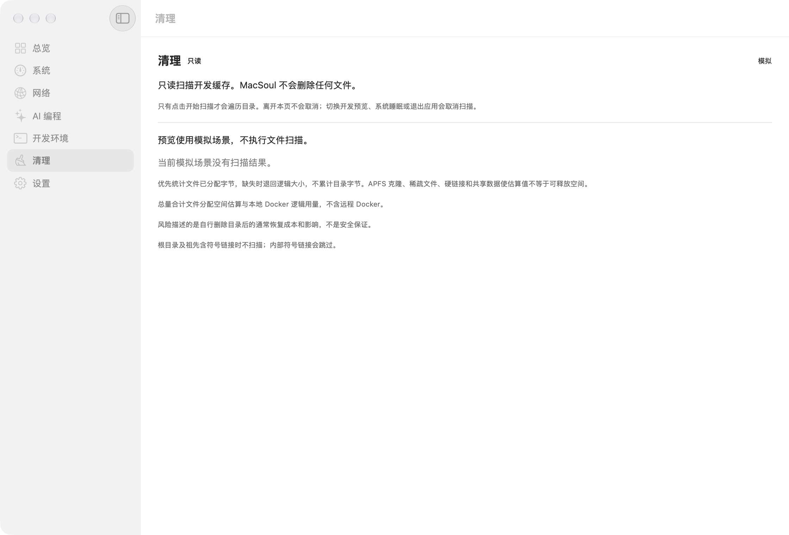
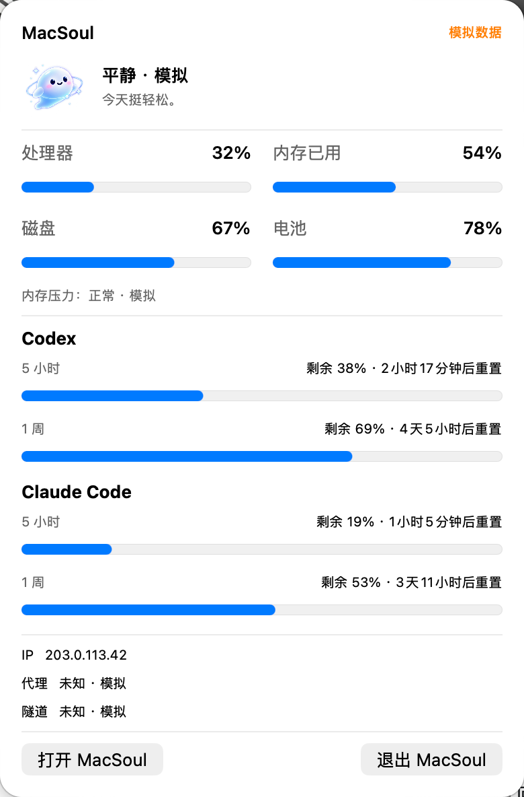

<p align="center">
  
</p>

<h1 align="center">MacSoul</h1>

<p align="center"><strong>一个有点嘴欠的 macOS 开发者伴侣。</strong><br>Your Mac knows what you're building.</p>

<p align="center">原生 SwiftUI · 菜单栏入口 · 系统状态 · AI 配额 · Soul</p>

<p align="center">简体中文 · <a href="README.en.md">English</a></p>

MacSoul 希望把系统状态、AI 编程额度、网络和本地开发环境放进一个原生 macOS 应用，让你不用在多个窗口之间来回寻找答案。住在里面的小灵魂，则会把需要关注的状态翻译成一句话：

> - CPU 持续高负载：「我的脑子要爆炸了。」
> - 内存压力严重：「我的胃快撑爆了。」
> - 状态恢复：「呼……终于安静了。」

**有趣的反馈是入口，清楚、可信的数据才是目的。**

> **MacSoul v0.1.0 Unsigned Developer Preview 已于 2026-10-07 公开发布。** 从 [GitHub Release](https://github.com/liu-657667/macsoul/releases/tag/v0.1.0) 下载预编译 Universal DMG 或 ZIP，无需安装 Xcode 或自行编译。当前版本未签名、未公证，首次打开可能受到 macOS 拦截；安装方法与验证边界见下方说明。

> **当前 main 已合入 v0.1.1 的四项改进；计划版本 v0.1.1-beta 准备中，尚未发布。** Beta 发行包及公开发布待后续独立授权阶段完成，目前下载仍为 v0.1.0。2026-10-22 核验 main 为 `66149dec`，[合并后 CI](https://github.com/liu-657667/macsoul/actions/runs/39743270528) SUCCESS；成功日志未暴露测试数量，不沿用历史本地计数，也不代表 Beta 发布批准。



> 这张图是早期产品概念，**不是当前 App 截图或功能验收证据**。其中的 VPN、服务延迟和清理按钮尚未实现；图中的指标布局不代表当前实时界面。

## v0.1.0 Developer Preview 截图

以下保留 v0.1.0 Developer Preview 的真实截图，数据均为内置模拟，不代表当前 main 或 Beta 的界面验收。AI 配额与重置时间均为 Developer Preview 模拟数据；Cleaner 展示未扫描状态，设置图为上半部分。该历史截图集已完成隐私检查并获 Owner 审核；概念图不替代实机画面。





*AI 编程 — Developer Preview。配额与重置时间均为 Developer Preview 模拟数据，不代表真实账户。*





更多界面：[设置页上半部分（开发预览）](docs/screenshots/v0.1/settings.png)。

*设置 — v0.1.0 unsigned Developer Preview。「登录时启动」不可用属于该历史 RC，不能作为当前 main 的结论；当前 Settings 已采用 Native User LaunchAgent，核心 Debug 实机启停已验收，Beta 分发包尚未验收。*

## 核心功能与当前状态

| 模块 | 要解决的问题 | 当前主分支 |
|---|---|---|
| **Soul** | 机器状态与恢复的简短反馈 | 本地确定性规则；CPU 持续阈值、memory pressure、冷却/恢复；静态图片，不依赖 LLM |
| **系统状态** | CPU、内存、磁盘、电池与开发进程 | 原生 CPU、内存已用/总量、压力事件、根卷磁盘、电源状态；进程 CPU delta / RSS；真实 warning 已观察，critical 尚未观察 |
| **AI 配额** | Codex / Claude Code 的适用窗口 | 当前 main 按连接握手与首个额度响应验证兼容性；#15 有限真实验证已接受；共享快照显示剩余百分比与 provider reset；Claude 无已验证来源时 unavailable |
| **网络** | 出口 IP、代理线索、连通性 | NWPath、独立 IPv4/IPv6、IPinfo 主源 → ident.me 备源、App/system 代理及隧道线索、可选匿名 HEAD 探测；Region 不采集 |
| **开发环境** | 运行时与开发相关监听端口 | Java/Node/Python/Go 与 SDKMAN/NVM/pyenv/goenv 上下文、缓存/刷新、开发端口筛选与全部端口展开；停止命令仅复制 |
| **开发缓存** | 解释估算占用与内容 | Xcode/Gradle/Maven/npm/Homebrew，只读 Preview/drill-down；Docker 本地 logical usage，不遍历 VM；不清理 |


主窗口用于看细节，**菜单栏是所有 Mac 共用的快速入口**。不需要带刘海的屏幕；当前范围不实现 Notch 展示。

### AI 配额：有什么窗口，就显示什么

MacSoul 的目标是展示账户实际提供的额度窗口，而不是根据套餐名称猜测限制。Live 与 Mock 共用同一窗口契约：

| 返回的窗口或状态 | 展示方式 |
|---|---|
| 只有 Week，5h 明确不适用 | 摘要只显示 Week，不补一个假的 5h 进度条 |
| 同时有 5h 和 Week | 显示两个窗口 |
| 有效窗口已用 0% | 显示剩余 100%，不当作缺失 |
| 未报告、请求失败、数据过期 | 显示对应状态，不冒充不限额或最新数据 |

主窗口与菜单栏共用同一份状态。AI 模块不做 Token 成本分析、Agent 会话管理或自动模型选择。这里讨论的是 **Codex / Claude Code 配额**，不是把 ChatGPT 聊天额度混在一起。

设置中可以切换 MacSoul 自身的跟随系统、浅色和深色外观，以及简体中文和英文；这些选择不更改 macOS 的全局设置。

### v0.1.1 已合并改进与验收边界

- **Codex**（[#15](https://github.com/liu-657667/macsoul/issues/15)、[PR #21](https://github.com/liu-657667/macsoul/pull/21)）：以当前连接的握手和首个额度响应验证替代 exact-version 唯一准入。保留固定 CLI 来源、最小只读 RPC、适用窗口语义、schema/ID 校验与 fail-closed；版本信息仅供诊断，不保证未经验证的未来版本兼容。Limited Owner Acceptance 包括当时 CLI `0.162.0-alpha.17.2` 的有限独立协议会话和 App 三入口有限观察（PARTIAL_PASS）；App 内 CLI 版本与窗口类别未记录，长期运行、Sleep/Wake、性能、完整 UI/Accessibility 等仍未验证。
- **登录时启动**（[#16](https://github.com/liu-657667/macsoul/issues/16)、[PR #23](https://github.com/liu-657667/macsoul/pull/23)、[PR #24](https://github.com/liu-657667/macsoul/pull/24)）：当前 Settings 使用 Native User LaunchAgent；仅用户显式启用/关闭更改配置，生命周期与 Refresh 只观察。先安装到 `/Applications` 或当前用户 `~/Applications`，启用只配置下一次登录，不立即额外启动 App；移动后需显式关闭旧配置并重新启用。核心 Debug 实机启停 PASS，原 LA-P3 PARTIAL 保留；Accessibility 为 OWNER_DEFERRED，Beta 分发包未验收。保留的旧 SMAppService 类型不构成双轨注册，旧系统问题根因未完全确认。
- **字体与布局**（[#17](https://github.com/liu-657667/macsoul/issues/17)、[PR #22](https://github.com/liu-657667/macsoul/pull/22)）：统一 Settings/System、Dev/AI、Network/Cleaner、Overview/Menu Bar/Sidebar 的字体、字重、间距与信息层级；修复 Overview 背景、Cleaner 摘要标题和最低窗口高度下内容侵入标题栏的问题。Owner visual 为 PASSED_WITH_SCOPE；完整无障碍、持续 Resize 与所有窗口尺寸未获验证。
- **网络备源**（[#18](https://github.com/liu-657667/macsoul/issues/18)、[PR #19](https://github.com/liu-657667/macsoul/pull/19)）：IPinfo primary → ident.me fallback，IPv4/IPv6 独立；主源成功不查备源，失败后最多一次 fallback。实现已完成，Owner Live/UI 为 PARTIAL_PASS；[#20](https://github.com/liu-657667/macsoul/issues/20) 保留未观察/未执行项，按 Owner 当前计划在 Beta 后推进。

Completed 仅表示对应已接受范围。各项键盘、VoiceOver、Reduce Motion、Network 与跨 macOS / Intel 覆盖的具体限制见[Beta 准备与验证边界](docs/RELEASE.md#v011-beta-preparation--unreleased)，未完成项不自动全部视为发布 blocker。

### Soul：有个性，但不打扰

正常、忙碌、脑子过载、胃撑、低电量、休息，是同一个小灵魂的不同状态。当前可在模拟场景里预览图片和文案。

实时 Soul 联动使用本地规则、持续阈值、冷却与恢复反馈，不依赖大模型生成吐槽；CPU 瞬时尖峰不会直接触发状态切换。

## 预编译 App：v0.1.0 已公开发布

从 [v0.1.0 GitHub Release](https://github.com/liu-657667/macsoul/releases/tag/v0.1.0) 下载以下公开附件；该版本为 **Pre-release、非 Latest**。使用预编译 App 不需要安装 Xcode 或自行编译。

- [Universal DMG（推荐）](https://github.com/liu-657667/macsoul/releases/download/v0.1.0/MacSoul-v0.1.0-macos-universal-unsigned.dmg)
- [ZIP（备用）](https://github.com/liu-657667/macsoul/releases/download/v0.1.0/MacSoul-v0.1.0-unsigned.zip)
- [SHA256SUMS.txt（校验文件）](https://github.com/liu-657667/macsoul/releases/download/v0.1.0/SHA256SUMS.txt)

macOS 最低部署目标为 13.0；Universal 包含 arm64 与 x86_64，不代表已完成 Intel 实机或所有 macOS 版本测试。下载包及校验文件并核对 SHA-256 后，打开 DMG，将 MacSoul 拖到 Applications；ZIP 可解压后复制 App。先正常退出其它 MacSoul 实例。启动后在设置中确认或选择「开发预览」以使用模拟数据；已有设置可能保留先前模式，需要真实系统信息时再明确选择「实时系统」。

**UNSIGNED / UNNOTARIZED：首次打开可能被系统拦截。** 仅在确认来源和校验值可信后，按 [Apple 官方逐 App 打开说明](https://support.apple.com/en-us/102445)操作：尝试打开后，在系统设置 → 隐私与安全性中使用「仍要打开」（如可用）；不要关闭全局保护或清除 quarantine。首次 **BLOCKED_OBSERVED** 已记录；Owner 本人应用逐 App 安全例外后，确认浏览器候选的模拟主窗口、清晰模拟标识、菜单栏及正常退出。该候选 reopen 和 Applications 安装检查仍为 **NOT_RUN**，不宣称 Gatekeeper PASS。损坏提示或异常退出需另行调查。不提供 App Store、Homebrew 或自动更新。完整步骤和验证边界见[发布指南](docs/RELEASE.md)。

## 从源码体验开发预览

需要 macOS、完整 Xcode（含 Swift toolchain）和 Python 3。工程最低部署目标是 macOS 13；这不代表所有 macOS / Xcode 组合都已经测试，工具链与验收记录见[开发指南](docs/DEVELOPMENT.md)。体验当前预览不要求 Codex、Claude Code 或 AI API 密钥。

```bash
git clone https://github.com/liu-657667/macsoul.git
cd macsoul

./scripts/doctor.sh
./scripts/verify-v0.1.1.sh
./scripts/run-mock.sh
```

也可以在 Xcode 中打开工程：

```bash
open MacSoul.xcodeproj
```

运行预览脚本前，请先正常退出已运行的 MacSoul。应用默认使用开发预览数据；在 **Settings → 系统数据来源** 可选择「实时系统」，启用真实 System/Dev/Network 和已验证 AI Provider。切回开发预览后，可选择 `Codex: Week only`、高 CPU、内存压力等模拟场景；这些场景不会修改真实账户套餐，也不会给电脑制造真实高负载。

以上命令供源码开发使用；体验已公开的 v0.1.0 预编译 App 可直接使用上方下载链接，无需运行这些命令。

## 隐私与产品边界

本地优先不等于零联网。已发布的 v0.1.0 Live Network 向 ipify 查询出口 IPv4/IPv6；**当前 main（计划用于尚未发布的 v0.1.1-beta）**改为 IPinfo 纯文本接口，主源成功不查备源，失败后最多尝试一次 ident.me。IPv4/IPv6 独立，每个地址族每次刷新最多两次查询、总超时预算 10 秒；保留 HTTPS/TLS、状态码、响应大小与 IP 地址族的严格校验，不绕过证书验证。启用 Connectivity probes 时向 GitHub/OpenAI/Anthropic 发匿名 HTTPS HEAD，不发送 API token、账户凭据或项目内容。OFF 仅关闭探测，不关闭公网 IP 查询。Preview 不启动这些外部请求；不采集 SSID/BSSID、位置或 Region，不修改 proxy/VPN/DNS/route。

公网 IP 服务可观察请求方的公网出口 IP；仅解析 IP 文本，不读取 GPS、国家、城市、ASN、设备物理位置、真实账户信息或用户项目内容，不持久化真实公网 IP、原始 HTTP 响应或代理凭据。主备均失败时，仅保留上次有效地址及来源并标记 Stale；没有成功历史时显示 Unavailable，不支持的地址族显示 Unsupported。当前 Network 详情区区分最近成功时间、最近尝试时间、实际成功来源、查询状态及最近失败原因。Owner Live/UI 仅 PARTIAL_PASS；完整服务可达性、目标设备代理/TLS/IPv6 与交互需分别验证，其他机器或终端的可达性不证明 App 自动 fallback。

当前 main 的 Codex 仅启动固定 ChatGPT.app bundled CLI app-server；同一可执行文件的版本信息仅供诊断，每次连接都验证握手与首读，仅发送 initialize、initialized、account/rateLimits/read，消费最小 rate-limit 字段；不读取 account profile、prompts/threads、不发模型推理、不操作登录或配额。协议 usedPercent 保持原义，UI/进度条统一显示 remaining。5h 只有已验证 machine-readable capability 才能判为不适用，缺失窗口本身不足以判断。Claude 当前只检查 executable/version，安装不代表有订阅。

Cleaner 只读明确解析的 cache roots，不上传路径或内容；跳过符号链接，限制 Preview 边界。Docker 只查询本地 Engine logical usage，远程 context 不计入本机总量，不扫描 Docker.raw/VM。当前登录启动使用用户级 LaunchAgent，仅用户显式操作更改配置；已接受的 Debug 实机启停不替代后续 Beta 分发包验证。

### 限制

- 配额是 Provider 上报，不是官方 SLA；Codex 按当前会话协议验证，不支持的方法或响应结构仍 fail closed；#15 的有限真实验证不保证所有未来 CLI、长期运行或完整 UI/Accessibility。Claude 无 verified source 时不可用。
- 估算占用不是精确可回收字节；APFS clone/shared blocks、稀疏文件、hard links/purgeable 空间会造成差异。Docker logical usage 不是 VM 物理占用。
- 监听端口不是冲突；复制 `kill -TERM <PID>` 不执行，用户执行前需确认 PID 未复用。
- NWPath connected 不等于互联网健康；HTTP 401/405 只证明 transport reachable，不证明认证或完整服务健康；隧道线索不证明 VPN routing。
- v0.1 无 cleanup/Trash、Notch、历史时间线；不会人为耗尽内存或 quota 来验收。

### v0.1.0 历史性能

以下 Day 5–7 数据仅属于 v0.1.0，不是当前 main 或 Beta 的性能证据。Day 5 在 Mac14,9、12 logical CPUs、16 GiB、macOS 27.0.1 / Xcode 27、unsigned Release、Codex 0.160.1 上测量。支持版本 menu-bar-only 5 分钟：MacSoul 平均 CPU 约 0.0057%，RSS 平均约 53.4 MB / 最大约 63.0 MB；Codex 子进程单独测量。详见[方法与限制](reports/day-5-performance-hardening-2026-10-04.md)。Day 6 更长测量见[历史报告](reports/day-6-review-hardening-2026-10-07.md)，不把尚未执行的测量写成 PASS。

v0.1.0 Day 7 五分钟结果：CPU avg / p95 / max 为 0.012488% / 0.039502% / 0.063822%；RSS start / end / avg / max 为 100.483 / 79.479 / 88.107 / 100.483 decimal MB。原始判定为 CPU PASS、RSS REVIEW；Owner 接受为 **RSS REVIEW ACCEPTED by Owner for this finite v0.1.0 RC observation.** 100 MB 目标及 150 MB 调查门槛不变，不声称全程低于 100 MB。

这些是有限环境/时间结果，不保证所有机器 <0.5%，也不证明未来不可能泄漏。

## 接下来做什么

| 阶段 | 交付重点 |
|---|---|
| **已完成：v0.1.0 核心能力集成** | System / Dev / Network / Codex、只读 Cleaner；Day 6 review、无障碍、设置与持续性能验收按当时范围收口，属于 v0.1.0 历史记录 |
| **已公开：v0.1.0** | [Unsigned Developer Preview](https://github.com/liu-657667/macsoul/releases/tag/v0.1.0) 于 2026-10-07 公开发布；Pre-release、非 Latest，Universal DMG / ZIP 与校验文件可公开下载；仍未签名、未公证 |
| **准备中：v0.1.1-beta** | 四项改进已合入 main；当前为 Phase 1 文档候选，Beta 打包与公开发布待后续独立授权 |
| **Beta 后：Network Live/UI** | 按 Owner 当前计划推进 [#20](https://github.com/liu-657667/macsoul/issues/20)，保留未观察、未执行和部分通过项 |
| **v0.2.0 计划** | 单独设计 Cleaner cleanup/Trash/确认、Maven/Gradle Build Tools、Docker 扩展，不是现有功能 |

[当前任务状态](docs/STATUS.md)是开发进度入口。截图、自动测试、真实功能、性能和全量交互验收分别记录。v0.1.0 历史记录中，菜单栏小图标保持 DRAFT；[Day 6 安全 Preview 截图 checklist](reports/day-6-review-hardening-2026-10-07.md)已获接受，D7-07 实机截图已采集并完成隐私检查，已获 Owner 审核，不以概念图代替；GIF 为可选。

## v0.1.0 公开发行与历史 RC 验收状态

本节的 365 tests、Archive、包哈希及 Owner 验收均归属 v0.1.0，未迁移为 Beta 证据，也未在本轮重新执行。

版本 0.1.0 / build 1 的本地 unsigned Release、zip、解压资源与 SHA-256 核对已通过；截图集 Owner 审核已通过；最终 Owner Live 回归 PASS，CPU PASS、RSS REVIEW ACCEPTED；接受范围仅本地 unsigned RC，[PR #10](https://github.com/liu-657667/macsoul/pull/10) 已正常合并，[main CI 37614072470](https://github.com/liu-657667/macsoul/actions/runs/37614072470) SUCCESS。此次 CI 与此前本地 365 tests / 0 failures / 0 skips 分开记录；CI 成功日志未暴露测试计数。构建、测试、打包、签名、公证和公开发布分别记录。见[发布指南](docs/RELEASE.md)、[最终报告](reports/FINAL.md)与[更新记录](CHANGELOG.md)。[v0.1.0 Release](https://github.com/liu-657667/macsoul/releases/tag/v0.1.0) 已公开；三个附件的匿名下载、大小、SHA256 与校验文件内容核对通过，DMG 可挂载，DMG / ZIP 中全部 7 个 App 文件匹配已接受 Archive。公开发行没有扩大既有 RC 的有限验收范围；仍无签名安装包或 Gatekeeper PASS 声明。

## 参与开发

欢迎围绕 macOS / Xcode 兼容性、界面可读性、可复现 Bug 和真实数据接入提交 [Issue](https://github.com/liu-657667/macsoul/issues) 或 Pull Request。反馈请注明环境、分支或提交号、复现步骤，并先移除日志和截图里的敏感信息。

[贡献指南](CONTRIBUTING.md) · [开发指南](docs/DEVELOPMENT.md) · [产品设计](docs/DESIGN.md) · [技术架构](docs/ARCHITECTURE.md) · [任务状态](docs/STATUS.md)

使用 Coding Agent 开发时，从 [AGENTS.md](AGENTS.md) 和当前任务开始。普通体验者不需要先阅读七天计划、审查报告或模型配置。

## License

MacSoul 有权授权的自有代码采用 [MIT License](LICENSE)，版权声明为 `Copyright (c) 2026 liu-657667`。Cleaner 扫把图标来自 Phosphor Icons；其原始版权和许可随 App 收录于 [ThirdPartyNotices.txt](MacSoul/Resources/ThirdPartyNotices.txt)。其他第三方内容保留原有许可与声明，视觉资源来源见[资源说明](docs/ASSET-SOURCES.md)。历史输入、参考图和第三方素材不因根目录的许可证自动获得新的授权。
